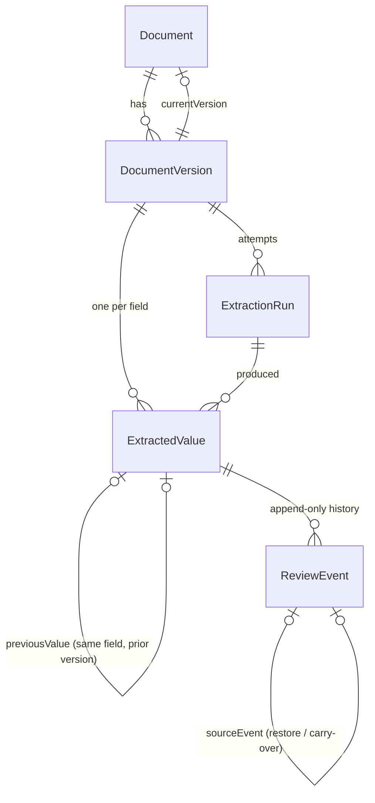

# Document review: PDF → LLM extraction → human review

PDFs go in, an LLM extracts each field together with the exact passage it came from, and a reviewer approves or corrects every value beside its source. When a revised PDF arrives, reviews whose evidence didn't change carry over; only what changed comes back for review.

- **Live:** https://lomi-take-home.vercel.app (UI) · https://api-production-7892467b.up.railway.app (API)
- **The brief:** [BRIEF.md](BRIEF.md) · **decision log with full reasoning:** [DECISIONS.md](DECISIONS.md)

---

## Run it

```sh
cp .env.example .env        # put your OPENROUTER_API_KEY in it
docker compose up
```

Open http://localhost:3000. Compose starts Postgres, Redis, S3-compatible storage (SeaweedFS), runs migrations, seeds **v1** of the three fixtures, then starts the API (:4000), worker and UI (:3000). Without a key everything still runs, but each extraction ends `failed` with "set OPENROUTER_API_KEY"; add the key, `docker compose up -d worker`, then hit *Retry* on the document.

**What to click first**

1. **Market report**: six fields; *Median household income* isn't in the document, so it's a **gap** with the model's reason, not a guess.
2. **Invoice**: hover a highlighted field in the document, or in the sidebar list, to preview it in the review card floating over the document. Click to pin it; click empty space or press `Esc` to dismiss. Approve (`A`), correct (`C`), undo/redo (`U` / `Shift+U`), step through fields with `J`/`K`. The sidebar's stage row (Upload → Extract → Review) shows where the document is; hover the review bar for the breakdown.
3. Approve everything on the invoice, then **drag `fixtures/documents/invoice-001.v2.pdf` onto the page** (or *Upload new version* in the version menu). It asks to upload it as v2; when it's extracted, exactly **Due date** and **Total amount** are back under review, each showing "was … · approved in v1" and the source quote with the change marked inline. The other three keep their approvals ("Carried over from v1" in the panel). The version picker still shows v1, read-only, with its own text and reviews.
4. Drop any PDF on the documents list to start a new document.

**Tests and tooling**

```sh
pnpm install
docker compose up -d postgres redis   # integration tests use real Postgres + Redis
pnpm test                             # turbo: builds deps, runs unit + integration tests
pnpm lint && pnpm typecheck
pnpm eval:models                      # re-run the LLM comparison (needs OPENROUTER_API_KEY)
```

For hot-reload development, run only the infrastructure in Docker and the apps natively. The api/worker dev scripts load `.env.example` defaults, then your `.env` on top:

```sh
docker compose up -d postgres redis s3 migrate
pnpm dev                              # turbo: api :4000, worker, web :3000 with hot reload
```

---

## Monorepo layout

pnpm workspaces + Turborepo. `build`, `typecheck`, `lint` and `test` all go through `turbo.json`; `test` depends on `^build` and `db:generate`, so a cold `pnpm test` generates the Prisma client and builds the packages it needs first.

```
apps/
  web        Next.js review UI                 → Vercel
  api        Fastify HTTP API (thin)           → Railway
  worker     BullMQ consumer + reconciler      → Railway
packages/
  core       pure domain, no I/O: field definitions, normalization,
             evidence check, extraction validation, carry-over rule
  services   use cases over Postgres/Redis/S3: upload, new version,
             retry, run processing, reconciler, read models, reviews, seed
  db         Prisma schema, migrations, client
  extraction OpenRouter provider, prompt, PDF parsing, model eval harness
  queue      BullMQ queue/job definition and Redis connection
  storage    S3 client (SeaweedFS locally, Railway bucket in prod)
  tsconfig, eslint-config   shared tooling
```

The boundaries follow what changes for different reasons:

- **`core` holds the rules the brief tests hardest** (hallucination defense, "unchanged" across versions). It has no I/O, so those rules are unit-tested in milliseconds.
- **`services` holds every use case; `api` and `worker` are adapters** (HTTP and BullMQ). The integration tests call `services` directly against real Postgres and Redis, with no HTTP server or live worker, and they exercise exactly the code production runs.
- **`extraction` sits behind an `ExtractionProvider` interface.** Tests use a deterministic fake that reads the real fixture text; the eval harness uses the real provider through the same validation path the worker uses.
- **One Dockerfile** builds any Node app (`--build-arg APP=api|worker|web`), using `turbo prune` so each image installs only what that app needs.

---

## Schema



- **`DocumentVersion`** is the unit of extraction. It stores the S3 key and sha256 of the PDF and the **parsed text**, so evidence validation and the review UI for version N always use N's own text, even after N+1 exists. Its status is `queued | extracting | extracted | failed | superseded`.
- **`ExtractionRun`** is one attempt to extract a version: status, lease, claim token, claim count, plus the **full prompt and raw LLM response** for debugging. Retries create a new run (`attempt + 1`); crash recovery reclaims the same run.
- **`ExtractedValue`** is **immutable LLM output**: value, normalized value, verbatim evidence, or `null` + `gapReason`. `UNIQUE(versionId, field)` makes extraction idempotent. `previousValueId` links the same field across versions; that's how the UI shows "v1 was X, approved".
- **`ReviewEvent`** is an **append-only** log per value. Every human action (approve, correct, restore/undo, reset) and every system carry-over is an event; each event also stores the effective `state` and value after it, so the latest event alone says what the value is now.

**Corrections live beside the value, never over it.** The model's output and evidence are never edited, so you can always answer "what did the LLM say, and what did a human decide?", and carry-over can compare evidence that was never touched. The UI shows the effective value inline, with the model's value struck through beside it. Undo/redo just appends `restored` events, so history stays complete.

---

## How extraction is coordinated

**Postgres is the source of truth; Redis only coordinates.** A BullMQ job carries nothing but a run id. Everything a user can see (versions, run outcomes, values, reviews) is in Postgres.

```
POST /documents ─► S3 put ─► tx{ Document, Version(queued), Run(queued) } ─► enqueue(jobId = runId) ─► 202
                                                                               │ (best effort; if Redis is
                                                                               │  down, the reconciler enqueues)
worker ─► claim run (atomic UPDATE … WHERE queued OR lease expired; new claim token, lease 60s)
       ─► parse PDF once, store text ─► LLM ─► validate evidence ─► tx{ lock run, check token,
          insert values, carry-over events, run → succeeded, version → extracted }
```

How each failure the brief tests is handled:

| Scenario | What happens |
|---|---|
| Upload | Returns 202 once the PDF is stored and the run is recorded; the LLM is never on the request path. |
| Same version extracted twice (retry, crash recovery, impatient user) | Only one worker can claim a run; a commit only lands if its claim token still matches; `UNIQUE(versionId, field)` is the backstop; a partial unique index allows one active run per version; `jobId = runId` dedupes in BullMQ. |
| Worker killed mid-extraction | The run stays `extracting` until its lease expires (a live worker heartbeats every 20s). The **reconciler** (on worker boot, then every 30s) re-enqueues it and another claim picks it up. After 3 crashed claims, the run is `failed` (retryable) instead of looping. |
| `FLUSHALL` + restart | Nothing to lose: Redis held only copies of run ids. On boot the reconciler re-enqueues every `queued` run and every expired `running` one. It removes finished BullMQ jobs with the same id first, because BullMQ silently ignores `add()` for a retained jobId. Measured: kill the worker mid-run, `FLUSHALL`, `docker compose restart` → extracted 64s later, reviews untouched. |
| LLM / parse / malformed-output error | Recorded on the run and the version as `failed` with the message; `POST /documents/:id/retry` creates attempt N+1. Never an unhandled exception. |
| Stale worker finishes late | Its claim token no longer matches, so the commit is discarded. |

**Hallucination defense.** Every quote must appear verbatim in this version's parsed text. Whitespace, line breaks, ligatures and typographic quotes are folded; case and digits are not. Anything else becomes a gap with a reason: the quote isn't in the text, the value isn't a valid date/amount/number, the field is missing from the response, or the model said the field isn't present. The rejected value is kept for debugging but never shown as a value.

---

## Decisions the brief left open

Short versions; [DECISIONS.md](DECISIONS.md) has the reasoning.

| Decision | Choice |
|---|---|
| **New version while the previous one is still extracting** | **Supersede.** Accept v(N+1) immediately; mark vN `superseded` and cancel its run in the same transaction (uploads for one document are serialized with a row lock). If vN's LLM call finishes later, its commit is discarded. Carry-over diffs against the last *extracted* version. Uploading identical bytes is a no-op (200). |
| **What "unchanged" means** | Same field, same **canonical value** (`$5,230.29` = `5230.29`), **and the prior version's evidence passage still appears verbatim in the new text**. It doesn't depend on positions, so inserted paragraphs don't matter, and it doesn't rely on the LLM picking the same quote twice. v2 of the invoice repeats "2025-09-14" in a new sentence, so a quote-equality rule could wrongly flag *issue date*. Gaps never carry over. Fuzzy matching was rejected: it can wave through `$5,230` vs `$5,280`. |
| **Correction model** | Annotation beside the value (see Schema). |
| **Parsed text** | Stored per version, parsed once. |
| **UI freshness** | Poll every 2s **only while something is queued/extracting**, otherwise refresh on focus. Extraction takes seconds and reviewers are few; SSE would add pub/sub fan-out and long-lived cross-origin connections for no real gain. |
| **LLM** | OpenRouter (strict JSON-schema output), default **`openai/gpt-6-luna`**, set by `EXTRACTION_MODEL`. Chosen from a recorded eval of 8 models × 4 fixtures × 2 runs through the real validation path ([results](packages/extraction/eval/RESULTS.md)). 7 of 8 scored 100% and none invented the missing income field, so the fixtures don't separate models on accuracy. Luna was the cheapest ($0.00019/doc) and among the fastest (2.7s p50). Because of the evidence check, a cheap model's failure mode is more gaps to review, not silent wrong values. |
| **Hosting** | UI on Vercel; API, worker, Postgres, Redis and a bucket on Railway (BullMQ needs a long-running worker, which serverless functions can't host). |
| **Files** | Original PDFs in S3-compatible object storage, content-addressed keys. |

The UI's design language is a visual reference to [Midday](https://github.com/midday-ai/midday). Midday is AGPL, so no code was copied; components are shadcn/ui (MIT) with our own tokens.

---

## Performance notes

From inside the API container, the endpoints answer in **10–40ms**. Every response carries a `Server-Timing` header, so the browser's network panel shows server time next to total time. From Asia, total latency is ~400ms because everything runs in Railway's US East region; that's network distance, not code. So the UI is built not to wait on the network:
- review actions are optimistic and roll back with a toast on failure
- the document list prefetches details on hover
- cached data shows instantly and refreshes in the background
- the previous extracted version stays on screen while the next one extracts

---

## What I cut, and what's next

- **Playwright end-to-end tests.** The integration tests cover the behaviours the brief tests (idempotency, crash recovery, FLUSHALL, supersede, carry-over, hallucinated evidence, reviews), but nothing drives the browser. Next: upload → review → drop v2 → assert only two values pending.
- **CI.** The turbo pipeline is real, but there's no GitHub Actions workflow running it with Postgres/Redis service containers yet.
- **Auth.** There are no users; reviews are attributed to "reviewer". The schema already records a reviewer per event.
- **OCR.** A scanned PDF with no text layer fails with "PDF contains no extractable text" instead of being processed.
- **Original PDF viewer.** The review canvas shows the parsed text, which is what the evidence is validated against; a PDF view with highlighted regions would need text positions.
- **Automatic retries for transient LLM errors.** The SDK retries twice; after that it's a visible failure plus a manual retry. A backoff policy for 429/5xx would be next.
- **Vercel deploys run from the CLI** (`vercel build` + `deploy --prebuilt`), because the app root sits inside the monorepo. Connecting the GitHub repo would make pushes deploy.
- **Undo/redo stacks live in the browser tab.** The history itself is server-side and complete; only "what can I redo" resets on reload.

## At 10,000 documents

- **Reads.** `GET /documents` loads every current value to compute progress. I'd add pagination and a denormalized progress row per version, updated in the same transaction as each review event. Review history reads are fine with the existing `(valueId, createdAt)` index.
- **Reconciler.** It scans `ExtractionRun` by `(status, leaseUntil)`, which is already indexed. With several workers I'd make each sweep take a Postgres advisory lock so they don't redo each other's work.
- **Throughput and cost.** Make worker concurrency per-provider with rate-limit-aware backoff, and use OpenRouter's batch endpoints (~50% cheaper) for non-urgent backfills. Track cost per run (already stored in the raw response) per day.
- **Storage.** Parsed text stays in Postgres (it's small and it's what review reads), with a sweep for orphaned PDFs from failed transactions.
- **Model quality.** Grow the eval set with real, messier documents before trusting a cheap default model. Track gap and rejection rates per model in production as the early warning.
- **Multi-tenancy.** Add a tenant id on `Document`, row-level scoping in `services`, and per-tenant field definitions instead of the hard-coded three types.
